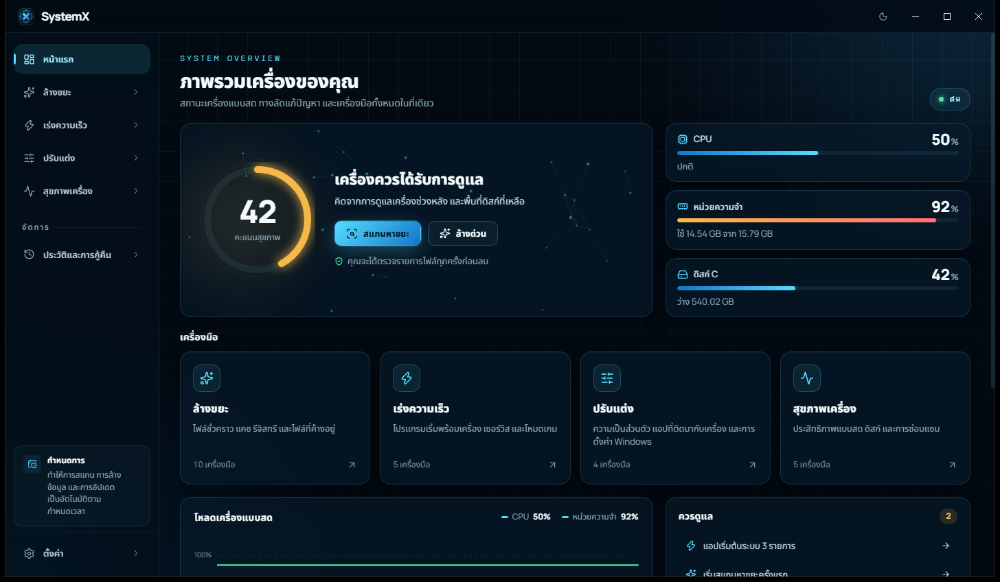
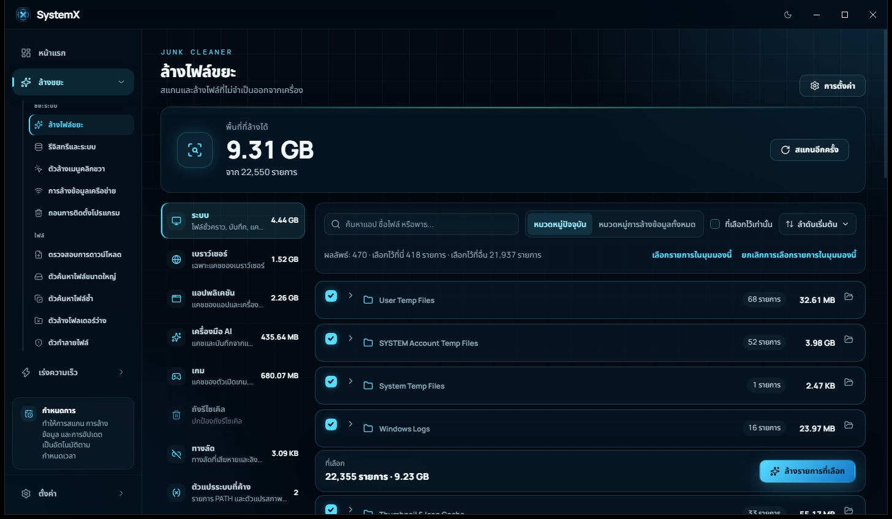
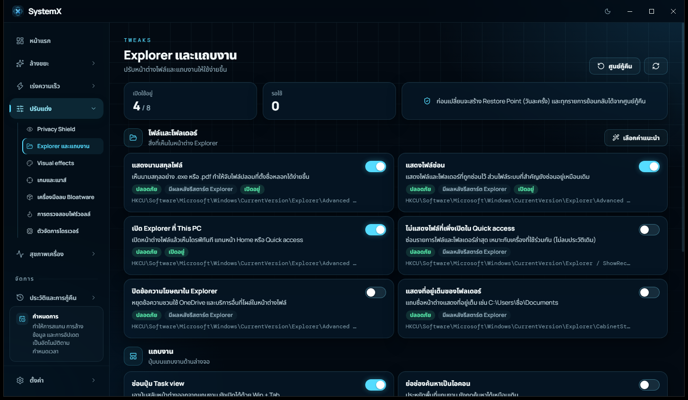
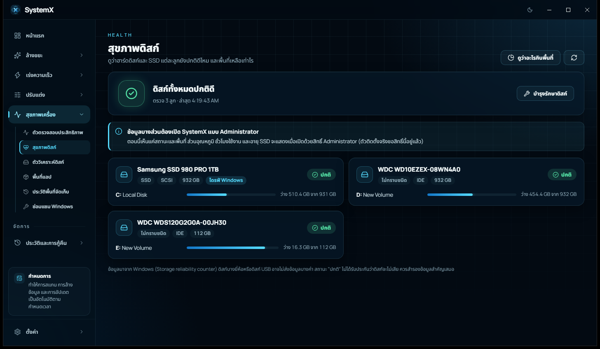
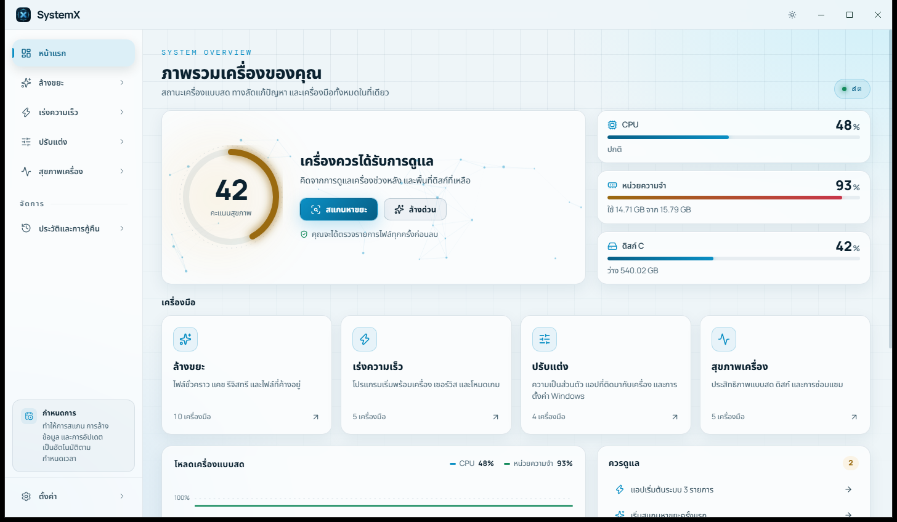

# SystemX

**ไทย** · [English](#english)

โปรแกรมดูแลเครื่อง Windows: ล้างไฟล์ขยะ เร่งความเร็วเครื่อง ปรับแต่ง Windows และดูสุขภาพดิสก์ในที่เดียว
แจกฟรี · ภาษาไทยและอังกฤษ · รองรับ Windows 10 (เวอร์ชัน 2004 ขึ้นไป) และ Windows 11 (64-bit)

## ดาวน์โหลดและติดตั้ง

1. ไปที่หน้า [**Releases ล่าสุด**](https://github.com/ResetconnectX/SystemX-releases/releases/latest) แล้วดาวน์โหลดไฟล์ `SystemX-Setup-<เวอร์ชัน>.exe`
2. ดับเบิลคลิกไฟล์ แล้วกด **ใช่** เมื่อ Windows ถามสิทธิ์ผู้ดูแลระบบ (SystemX ต้องใช้สิทธิ์นี้เพื่อแก้ค่าระบบและสร้าง Restore Point)
3. ติดตั้งเสร็จแล้วโปรแกรมจะเปิดขึ้นเอง และมี shortcut บน Desktop กับเมนู Start

### ถ้า Windows ขึ้นว่า "Windows protected your PC"

ตอนนี้ SystemX ยังไม่ได้เซ็นด้วย code signing certificate ระบบ SmartScreen ของ Windows จึงเตือนโปรแกรมใหม่ที่ยังมีคนดาวน์โหลดไม่มาก ข้อความนี้ไม่ได้แปลว่าไฟล์มีไวรัส

1. กด **More info** (ข้อมูลเพิ่มเติม)
2. ตรวจว่าชื่อไฟล์เป็น `SystemX-Setup-<เวอร์ชัน>.exe` แล้วกด **Run anyway** (เรียกใช้ต่อไป)

ดาวน์โหลดจากหน้า Releases ของ repo นี้เท่านั้น ถ้าเจอไฟล์ SystemX จากที่อื่น อย่าเปิด

### อัปเดต

SystemX เช็กเวอร์ชันใหม่จากหน้านี้เอง และบอกให้รู้ในหน้า **ตั้งค่า → เกี่ยวกับ** ตั้งให้ดาวน์โหลดอัตโนมัติ หรือกดอัปเดตเองก็ได้

## ทำอะไรได้บ้าง

| หมวด | รายละเอียด |
|---|---|
| **ล้างขยะ** | ไฟล์ชั่วคราว, แคชเบราว์เซอร์และแอป, ถังรีไซเคิล, ไฟล์ขนาดใหญ่, ไฟล์ซ้ำ, โฟลเดอร์ว่าง แสดงรายการและขนาดก่อนลบทุกครั้ง |
| **เร่งความเร็ว** | โปรแกรมเริ่มพร้อมเครื่อง, Services (ซ่อนรายการเสี่ยงไว้หลังโหมด Advanced), Power plan, Game Mode |
| **ปรับแต่ง** | Privacy / Telemetry, Explorer และแถบงาน (รวมเมนูคลิกขวาแบบเดิมของ Windows 11), Visual effects, เกมและเมาส์, ลบแอปติดเครื่อง (โหมด Advanced) |
| **สุขภาพเครื่อง** | สุขภาพดิสก์และ SSD, ตัววิเคราะห์พื้นที่ดิสก์, ประสิทธิภาพแบบสด, ซ่อมแซม Windows (DISM / SFC) |

| ล้างขยะ | ปรับแต่ง | สุขภาพดิสก์ |
|---|---|---|
|  |  |  |

มีทั้งธีมมืดและสว่าง ค่าเริ่มต้นตามธีมของ Windows

## ความปลอดภัยและความเป็นส่วนตัว

**ย้อนกลับได้**
- การปรับแต่ง (Tweak, Privacy), Services, Power plan และการปิดหรือลบโปรแกรมเริ่มพร้อมเครื่อง บันทึกค่าเดิมไว้ก่อนเปลี่ยนทุกครั้ง และกด **เลิกทำ** หรือกู้คืนทีละรายการได้จาก **ศูนย์กู้คืน**
- ก่อนปรับแต่งครั้งแรกของวัน SystemX จะสร้าง Windows Restore Point ให้ (ต้องเปิด System Protection ไว้ ถ้าสร้างไม่ได้จะถามก่อนว่าจะทำต่อไหม)

**ย้อนกลับไม่ได้ (โปรแกรมจะเตือนก่อนทุกครั้ง)**
- **ล้างไฟล์ขยะ** ลบไฟล์ถาวร ไม่ผ่านถังรีไซเคิล ให้ดูรายการให้แน่ใจก่อนกดล้าง รหัสผ่านและคุกกี้ของเบราว์เซอร์จะไม่ถูกเลือกไว้ให้ล่วงหน้า
- **ลบแอปติดเครื่อง** (Debloater) ลบเฉพาะบัญชีที่ใช้อยู่ ติดตั้งคืนได้จาก Microsoft Store โดยมีปุ่มลิงก์ให้ในโปรแกรม

**ข้อมูลของคุณ**
- SystemX ไม่เก็บและไม่ส่งข้อมูลการใช้งานหรือข้อมูลส่วนตัวไปที่ไหน ไม่มีโฆษณาและไม่มีระบบติดตาม
- การเชื่อมต่ออินเทอร์เน็ตมีแค่: เช็กอัปเดตจากหน้า Releases นี้, หน้าตัวจัดการไดรเวอร์ที่ถาม Windows Update ผ่านตัว Windows เอง และลิงก์ที่คุณกดเปิดเอง
- การตั้งค่า บันทึกกู้คืน และไฟล์สำรอง เก็บไว้ในเครื่องที่ `%APPDATA%\SystemX` และยังเก็บไว้หลังถอนการติดตั้ง เพื่อให้ติดตั้งใหม่แล้วยังย้อนการเปลี่ยนแปลงเดิมได้

## ถอนการติดตั้ง

Settings ของ Windows → Apps → **SystemX** → Uninstall
ถ้าต้องการลบข้อมูลทั้งหมดด้วย ให้ลบโฟลเดอร์ `%APPDATA%\SystemX` หลังถอนการติดตั้ง

## รายงานปัญหา

แจ้งได้ที่หน้า [Issues](https://github.com/ResetconnectX/SystemX-releases/issues) ของ repo นี้ บอกเวอร์ชันของ SystemX, เวอร์ชัน Windows และขั้นตอนที่ทำให้เกิดปัญหา

## ไลเซนส์

SystemX เป็นฟรีแวร์ (ไม่เปิดซอร์ส) สร้างต่อจาก [Kudu](https://github.com/AdventDevInc/kudu) (MIT License) และซอฟต์แวร์โอเพนซอร์สอื่นๆ รายการไลเซนส์ทั้งหมดอยู่ในไฟล์ `THIRD_PARTY_NOTICES.txt` ในโฟลเดอร์ที่ติดตั้งโปรแกรม หรือกด **ตั้งค่า → เกี่ยวกับ → ดูไลเซนส์ของซอฟต์แวร์ที่ใช้**

---

# SystemX (English)

A Windows care app: clean junk files, speed up startup, tweak Windows and check disk health in one place.
Free · Thai and English · Windows 10 (version 2004 or later) and Windows 11 (64-bit)

## Download and install

1. Open the [**latest release**](https://github.com/ResetconnectX/SystemX-releases/releases/latest) and download `SystemX-Setup-<version>.exe`
2. Run it and choose **Yes** when Windows asks for administrator rights (SystemX needs them to change system settings and create restore points)
3. SystemX opens when setup finishes, with shortcuts on the desktop and in the Start menu

### If Windows says "Windows protected your PC"

SystemX is not code-signed yet, so Windows SmartScreen warns about new apps that few people have downloaded. The warning does not mean the file contains malware.

1. Click **More info**
2. Check that the file is `SystemX-Setup-<version>.exe`, then click **Run anyway**

Only download SystemX from this repository's Releases page. Don't run copies from anywhere else.

### Updates

SystemX checks this page for new versions and shows them under **Settings → About**. Updates can download automatically, or you can install them yourself.

## Features

| Area | What it does |
|---|---|
| **Clean** | Temporary files, browser and app caches, Recycle Bin, large files, duplicates, empty folders. You always see the list and sizes before anything is deleted |
| **Speed up** | Startup apps, Services (risky ones stay behind Advanced mode), power plans, Game Mode |
| **Tweaks** | Privacy / telemetry, Explorer and taskbar (including the classic Windows 11 right-click menu), visual effects, gaming and mouse, built-in app removal (Advanced mode) |
| **Health** | Disk and SSD health, disk space analyzer, live performance, Windows repair (DISM / SFC) |

| Clean | Tweaks | Disk health |
|---|---|---|
|  |  |  |

Dark and light themes are included; SystemX follows your Windows theme by default.

## Safety and privacy

**Can be undone**
- Tweaks, privacy settings, services, power plans and startup changes (including removed startup items) save the previous value first. Undo them from the snackbar or one by one in the **Recovery Centre**
- Before the first tweak of the day, SystemX creates a Windows restore point (System Protection must be on; if it can't, SystemX asks before continuing)

**Cannot be undone (SystemX always warns first)**
- **Junk cleaning** deletes files permanently, not to the Recycle Bin. Review the list before cleaning. Browser passwords and cookies are never pre-selected
- **Built-in app removal** (Debloater) removes apps for the current account only. Reinstall them from Microsoft Store using the link SystemX keeps for you

**Your data**
- SystemX does not collect or send usage or personal data. No ads, no tracking
- It only goes online to check this Releases page for updates, to ask Windows Update for drivers (through Windows itself) on the Drivers page, and to open links you click
- Settings, recovery records and backups stay on your PC in `%APPDATA%\SystemX` and are kept after uninstalling, so a reinstall can still undo earlier changes

## Uninstall

Windows Settings → Apps → **SystemX** → Uninstall
To remove everything, delete `%APPDATA%\SystemX` afterwards.

## Report a problem

Open an [issue](https://github.com/ResetconnectX/SystemX-releases/issues) in this repository with your SystemX version, Windows version and the steps that cause the problem.

## License

SystemX is freeware (closed source) built on [Kudu](https://github.com/AdventDevInc/kudu) (MIT License) and other open-source software. All licenses are listed in `THIRD_PARTY_NOTICES.txt` in the install folder, or under **Settings → About → Third-party licenses**.
